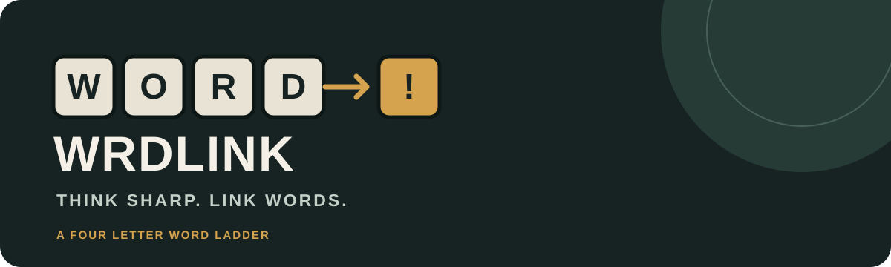

<p align="center">
  <strong>A focused four letter word ladder game.</strong><br>
  Change one letter per move. Find the route. Reach the target.
</p>

<p align="center">
  <a href="https://kaelith69.github.io/WRDLiNK-Web/">Play WRDLINK</a>
  ·
  <a href="https://github.com/Kaelith69/WRDLiNK-Web/issues">Report a bug</a>
  ·
  <a href="LICENSE">MIT License</a>
</p>

---

## The game

WRDLINK gives you a start word and a target word. Build a chain of valid four letter words between them, changing exactly one letter with every move.

The browser edition is a small, dependency free web app. It runs locally in the browser, remembers your current game, and can be installed on supported devices as a **Progressive Web App (PWA)**. After its first successful load, the game shell and dictionary are available offline.

## Play

**[Open WRDLINK](https://kaelith69.github.io/WRDLiNK-Web/)**

### How to play

1. Read the four letter **start word** and **target word**.
2. Enter a dictionary word that differs from your latest word by exactly one letter.
3. Submit the word to add it to your ladder.
4. Do not repeat a word already used in the current ladder.
5. Reach the target word to complete the level.
6. Continue to the next level and build your cumulative score.

Invalid entries do not change the chain or consume a move. Use **Share challenge** to send a branded 9:16 story card and the exact puzzle URL through your device's native share sheet. Use **Copy challenge link** separately when a destination such as Instagram Stories needs its own Link sticker. Anyone opening the URL receives the same start and target words and can solve it independently.

Browsers can request that autocomplete, autocorrection, spell checking, and writing suggestions be disabled for the game input. The operating system's keyboard toolbar and autofill service remain under device and keyboard control, so a website cannot guarantee that every suggestion strip or toolbar is hidden.

### Rules at a glance

- Every word contains exactly four letters.
- Every submitted word must exist in the bundled dictionary.
- Each move changes exactly one letter.
- A word cannot appear twice in the same chain.
- The target word must be the final word in the chain.

### Scoring

A new game starts with **25 points**. Every valid move immediately deducts **1 point**. Invalid entries do not change the score. A confirmed hint deducts its escalating hint price and automatically submits the suggested word, which also costs **1 move point**.

```text
Starting score = 25
Hint 1 = 5 points
Hint 2 = 6 points
Hint 3 = 7 points
Hint n = 5 + (n - 1)

Normal valid move = -1 point
Confirmed hint = -(hint price + 1 move point)
Level completion reward = +25 points
Score cannot fall below zero
```

The score is cumulative across levels. When a level is completed, **25 points are added** to the remaining score. The next level carries that balance forward rather than resetting it. Every new game starts a fresh run at 25 points. Hint prices restart at 5 for each new level.

The top bar labels each stage LV0, LV1, LV2, and onward. The challenge area has one share action, with a dedicated share icon and teal treatment, plus a contrasting amber new game action. The redundant standalone copy link button is removed. The top bar keeps the score and move count identifiable on mobile, including while the keyboard is open. The hint control displays the full deduction, including the automatically submitted move. Before confirmation, the dialog previews the exact total deduction and remaining balance. Cancelling costs nothing. Confirming submits the next word on a shortest valid route automatically.

Progress saves the cumulative score, current level, moves, and hint deductions. Result cards display the score after the level completion reward.

## Install the app

WRDLINK is a Progressive Web App. It does not need an app store or a separate installer.

### Desktop

1. Open the [WRDLINK web app](https://kaelith69.github.io/WRDLiNK-Web/) in a supported browser such as Chrome or Edge.
2. Wait for the first page load to finish.
3. Select the install icon in the browser address bar, or use the browser menu and choose **Install WRDLINK**.

### Android

1. Open the web app in Chrome.
2. Open the browser menu.
3. Select **Install app** or **Add to Home screen**, depending on the browser.

### iPhone and iPad

1. Open the web app in Safari.
2. Tap **Share**.
3. Choose **Add to Home Screen**.

Installation wording and availability vary by browser and operating system. The app must be served over HTTPS, which GitHub Pages provides.

### Offline support

The service worker caches the app shell, styles, game logic, dictionary, manifest, and app icon. The first visit requires an internet connection. Once the service worker has installed and cached those files, the game can load offline.

Game progress and theme preference are stored locally by the browser. Offline support does not provide account sync or cross device progress transfer. A service worker update is activated when the browser installs the newer app shell.

## Features

- **3,889 word dictionary** bundled locally. No external dictionary API.
- **Random puzzles** generated from valid paths in the dictionary.
- **Shortest route calculation** using breadth first search.
- **Move validation** for dictionary membership, letter changes, and duplicate words.
- **Level scoring** with 25 starting points, move deductions, escalating paid hints, and cumulative progression.
- **Paid hints** in the top bar, with an explicit total cost confirmation, immediate current score deduction, and automatic move submission. Costs escalate by one point per hint.
- **Friend challenges** with shareable links that reopen the exact start and target words.
- **Shareable result cards** exported as PNG images for messaging and social stories.
- **Persistent progress** using browser `localStorage`.
- **Light and dark themes** with saved preference and system theme detection.
- **Installable PWA** with a web app manifest, custom SVG app icon, and service worker.
- **Offline play** after the first successful app shell cache.
- **Responsive layout** for desktop, tablet, and mobile.
- **Accessibility support** including semantic controls, visible focus, live status announcements, reduced motion preferences, and non colour state cues.
- **No framework, build step, or runtime dependencies.**

## Run locally

For basic play, serve the repository root with any local static HTTP server. Opening `index.html` directly with a `file://` URL still runs the game, but service workers and PWA installation require a secure context such as HTTPS or localhost.

For example, with Python installed:

```bash
python -m http.server 8000
```

Then open [http://localhost:8000](http://localhost:8000).

## Run the tests

Node.js 18 or newer is required for the test suite.

```bash
npm test
```

The tests exercise the production game logic, dictionary, adjacency rules, 25 point scoring, escalating hint costs, total hint and move affordability, shortest route auto submission, hint persistence, puzzle generation, shared challenge loading, saved progress validation, and PWA metadata.

## Project structure

```text
.
├── .github/
│   └── workflows/
│       ├── deploy-pages.yml  # Static GitHub Pages deployment
│       └── test.yml          # Logic and PWA checks
├── assets/
│   ├── readme-banner.svg     # Repository README banner
│   └── wrdlink-icon.svg      # Installable app icon
├── index.html                # Accessible game shell and PWA metadata
├── manifest.webmanifest      # App name, display mode, scope, and icon
├── sw.js                     # Offline app shell and cache lifecycle
├── styles.css                # Responsive design and light/dark themes
├── app.js                    # Puzzle generation, validation, scoring
├── dictionary.js             # 3,889 four letter words
├── package.json              # Test command
├── tests/
│   ├── game.test.js          # Production game logic checks
│   └── pwa.test.js           # PWA metadata and deployment checks
├── LICENSE
└── README.md
```

## Privacy and local data

WRDLINK does not require an account. It does not include analytics, advertising, a backend, or cross device synchronization. The current game and theme preference are stored in the browser profile using `localStorage`.

If the same game is open in multiple tabs, a tab detects an external progress update and stops overwriting the newer saved snapshot. Reload that tab to continue from the latest saved game.

## Accessibility

The interface supports keyboard and touch interaction, visible focus, semantic form controls, concise status announcements, reduced motion preferences, and scrollable long word chains. Colour is not the only way game state is communicated.

Accessibility can vary across browser, operating system, assistive technology, and user settings. Contributions that improve these combinations are welcome.

## Technology

- HTML
- CSS
- Vanilla JavaScript
- Web App Manifest
- Service Workers and Cache Storage
- Browser `localStorage`
- Node.js built in test modules

## Deployment

The project is a static site and deploys through GitHub Pages. The workflow publishes the game runtime and PWA assets from the repository root when changes reach `main`.

For the first deployment, open **Settings → Pages** and select **GitHub Actions** as the deployment source. Subsequent pushes to `main` deploy automatically. The published app is served over HTTPS, which is required for service workers and PWA installation.

## License

WRDLINK is distributed under the **MIT License**. See [LICENSE](LICENSE) for the complete terms.
