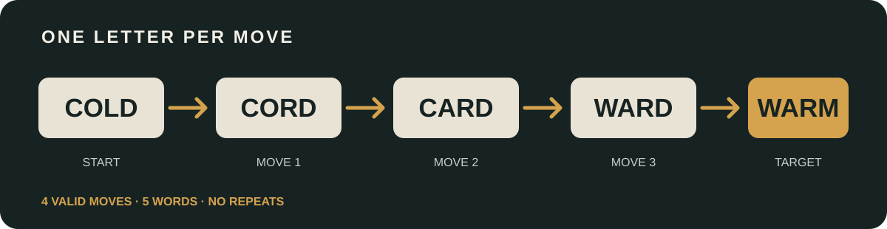
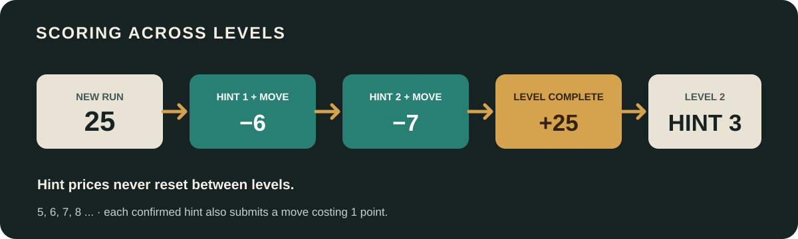
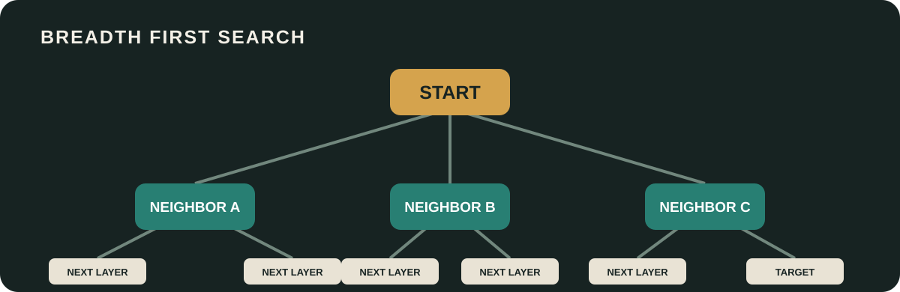
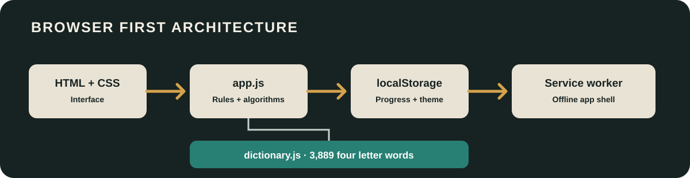

<p align="center">
  <strong>A four letter word ladder game built around graph search.</strong><br>
  Change one letter per move. Build a valid chain. Reach the target in as few moves as you can.
</p>

<p align="center">
  <a href="https://kaelith69.github.io/WRDLiNK-Web/">PLAY WRDLINK</a>
  ·
  <a href="https://github.com/Kaelith69/WRDLiNK-Web/issues">REPORT A BUG</a>
  ·
  <a href="LICENSE">MIT LICENSE</a>
</p>

---

## Contents

- [What is WRDLINK?](#what-is-wrdlink)
- [How to play](#how-to-play)
- [Worked example](#worked-example)
- [Rules and validation](#rules-and-validation)
- [Scoring and hint economy](#scoring-and-hint-economy)
- [How the algorithms work](#how-the-algorithms-work)
- [Application architecture](#application-architecture)
- [Progress, storage, and migration](#progress-storage-and-migration)
- [Friend challenges and sharing](#friend-challenges-and-sharing)
- [Install the app and offline play](#install-the-app-and-offline-play)
- [Run locally and test](#run-locally-and-test)
- [Project structure](#project-structure)
- [Technology](#technology)

## What is WRDLINK?

WRDLINK is a browser based word ladder game. Each puzzle gives you a four letter start word and a four letter target word. Your job is to connect them by entering valid dictionary words, changing **exactly one letter** each time.

The game is designed as a small, dependency free client side application. The dictionary, validation, puzzle generation, graph search, scoring, persistence, sharing, and interface all run in the browser. There is no game server or external dictionary API.

**[Play WRDLINK](https://kaelith69.github.io/WRDLiNK-Web/)**

## How to play

1. Read the **START** word and the **TARGET** word.
2. Enter a four letter word that differs from the most recent word by exactly one letter.
3. Submit it. A valid word is added to your chain and consumes one move.
4. Continue changing one letter at a time until the target is reached.
5. Complete the level to receive its completion bonus and unlock the next puzzle.
6. Keep an eye on the score and the hint price. Hint prices increase throughout the campaign, including after a level change.

The word entry is case insensitive. The game normalizes entries to uppercase before validation. On mobile, use WRDLINK's built in on screen keyboard, which suppresses the native software keyboard and keeps the game controls in view. Desktop users can continue typing with a physical keyboard. Invalid entries are rejected without changing the chain or consuming a move.

### The interface

- **Start and target:** the two endpoints of the current puzzle.
- **Level:** the campaign level indicator. The visible labels begin at LV0, then LV1, LV2, and onward.
- **Score:** the current campaign balance.
- **Moves:** the number of accepted transitions in the current chain.
- **Word entry:** the next candidate word.
- **Hint:** asks the shortest path solver for the next word and submits that word after confirmation.
- **Share challenge:** prepares a link and a share card for the current start and target.
- **Theme:** switches between light and dark appearance.
- **Next level:** appears after a successful solve.
- **New game:** starts a fresh run and resets the campaign score and hint sequence.

## Worked example

This example connects **COLD** to **WARM**. Every adjacent pair differs in one position.



| Step | Word | Change |
|---:|---|---|
| Start | COLD | Starting word |
| 1 | CORD | L becomes R |
| 2 | CARD | O becomes A |
| 3 | WARD | C becomes W |
| 4 | WARM | D becomes M, target reached |

This is a valid four move chain if all words are present in the bundled dictionary. The game also calculates the shortest possible route for a puzzle, so the completion message can distinguish a minimum move solution from a longer valid solution.

## Rules and validation

A submitted chain must satisfy all of the following:

- Every word has exactly four letters.
- Every word exists in the bundled dictionary.
- Every move changes exactly one letter.
- No word may be repeated in the same chain.
- The start word must remain the first word.
- The target word may only appear as the final word.
- The final word must equal the puzzle target.

Validation happens locally before the chain is changed. A rejected word does not increment the move count, deduct a move point, or enter the saved chain.

## Scoring and hint economy

Each new level starts with **25 points**. Accepted moves and confirmed hints reduce the current level score. The score never falls below zero.

### Normal moves

Every accepted move deducts **1 point**. Invalid entries cost nothing.

### Hints

Hints use the shortest route solver to reveal the next word on a valid shortest path. Confirming a hint automatically submits that word, so the deduction has two parts:

- The hint price.
- One additional point for the move that the hint submits.

The hint price increases by one for every confirmed hint within the current level. **It resets when the next level begins.** Cancelling the confirmation does not deduct points.

| Hint number in the current level | Hint price | Move cost | Total deduction |
|---:|---:|---:|---:|
| 1 | 5 | 1 | 6 |
| 2 | 6 | 1 | 7 |
| 3 | 7 | 1 | 8 |
| 4 | 8 | 1 | 9 |
| 5 | 9 | 1 | 10 |
| n | 5 + (n − 1) | 1 | 6 + (n − 1) |

The hint counter and accumulated hint penalty persist across reloads within the current level. Starting the next level or choosing **New game** resets the hint sequence to 5.

### Level completion

Completing a level ends the current score calculation. The next level begins with **25 points**, regardless of the previous level's remaining balance. The score is never allowed to fall below zero.

For example, if a player begins with 25 points, uses two hints, and makes no other moves:

- Hint 1 deducts 5 hint points and 1 move point.
- Hint 2 deducts 6 hint points and 1 move point.
- The remaining score is 12.
- Completing the level records that result.
- The next level starts at 25 points, and its first hint costs 5 hint points plus 1 move point.



The completion banner and result card show the remaining level balance. The next level resets to 25 points. A new game starts a fresh level at 25 points.

## How the algorithms work

The game models the dictionary as an **implicit, unweighted graph**:

- Each valid four letter word is a vertex.
- An edge connects two words when they differ at exactly one character position.
- Every edge represents one legal move.
- A route is a sequence of connected vertices from the start to the target.

The graph is not stored as a large list of every possible edge. Instead, the application builds a pattern index and generates neighbors when needed.

### 1. Dictionary loading and indexing

`dictionary.js` exposes a bundled set of **3,889 four letter words**. At startup, the application filters the set to uppercase four letter entries and builds a pattern index.

For each word, the index creates four patterns by replacing one character with an underscore.

Example:

```text
COLD
_OLD
C_LD
CO_D
COL_
```

Every word sharing a pattern differs only at the wildcard position, so it is a possible one move neighbor. To find the neighbors of a word, the game looks up its four patterns, collects the matching words, removes the word itself, and deduplicates the results.

This avoids comparing every dictionary word against every other word whenever a neighbor list is needed.

### 2. One letter comparison

The direct validator compares words character by character:

1. Reject immediately if their lengths differ.
2. Count positions where the characters differ.
3. Reject as soon as the count exceeds one.
4. Accept the transition only when the final difference count is exactly one.

A word identical to the previous word is not a move. A word differing in two or more positions is also invalid.

### 3. Breadth first search for shortest distance

The graph is unweighted because every legal move costs one move. The application uses **breadth first search (BFS)** to calculate the shortest distance between two words.

BFS explores the graph in layers:

1. Put the start word in a queue with distance zero.
2. Remove the next queued word.
3. Visit each unvisited neighbor and assign its distance as the current distance plus one.
4. Add those neighbors to the queue.
5. Stop when the target is reached.
6. Return the target distance. If the queue becomes empty first, no route exists.

Because every edge has equal weight, BFS discovers the target at its minimum possible number of moves.



### 4. Shortest path reconstruction

The hint system needs the actual route, not only its length. The shortest path routine performs BFS while recording a **parent** for every discovered word.

When the target is found, the algorithm follows the parent links backward from target to start, then reverses the collected sequence. This produces a shortest valid word ladder.

The routine accepts an exclusion list. Words already used earlier in the current chain are blocked, except for the current word at the search origin. This prevents a hint from suggesting a repeated word.

A hint takes the second word in the reconstructed path. That is the next legal move along a shortest remaining route.

### 5. Random puzzle generation

Random puzzles are generated from the same indexed graph:

1. Choose a random dictionary word as the start.
2. Perform a random walk through unused neighboring words.
3. Choose a desired walk length between three and seven moves.
4. Stop the walk if no unused neighbor is available.
5. Use the last word as the target.
6. Run BFS from start to target to calculate the optimal move count.
7. Accept the puzzle only when the target differs from the start, a route exists, and the generated walk contains enough words.
8. Retry up to 100 times before reporting a generation error.

The random walk creates a connected pair of endpoints. BFS then measures the actual shortest distance between them. The random walk itself is not necessarily the shortest solution.

### 6. Complexity

Let **V** be the number of dictionary words and **E** the number of legal one letter transitions.

- **Pattern index construction:** each word contributes four patterns, so index construction is proportional to **4V**, excluding the cost of storing the buckets.
- **Neighbor lookup:** examines the four relevant pattern buckets. Its practical cost depends on the sizes of those buckets.
- **BFS:** **O(V + E)** time and **O(V)** auxiliary space in the usual adjacency list graph model.
- **Path reconstruction:** **O(L)**, where **L** is the number of words in the returned path.
- **Sequence validation:** linear in the number of submitted words, with a fixed four character comparison per transition.

The implementation generates neighbors from the pattern index rather than materializing every graph edge up front.

## Application architecture

WRDLINK is a static browser application. It has no backend service, account system, build pipeline, or runtime package dependencies.



| File | Responsibility |
|---|---|
| `index.html` | Semantic interface, controls, dialogs, initial score display, and app metadata |
| `styles.css` | Responsive layout, themes, keyboard open layout, focus states, and motion preferences |
| `app.js` | Game state, validation, graph indexing, BFS, puzzle generation, scoring, sharing, and persistence |
| `dictionary.js` | Bundled word set |
| `manifest.webmanifest` | Installable PWA metadata and icon declarations |
| `sw.js` | App shell caching, offline navigation fallback, and cache version cleanup |
| `assets/` | App icons and README illustrations |
| `tests/game.test.js` | Production game logic, scoring, hint progression, challenge, and persistence tests |
| `tests/pwa.test.js` | HTML, responsive behavior, PWA metadata, service worker, and deployment checks |

### Browser state

The application keeps the active puzzle and campaign in one state object. It includes the score, level, puzzle endpoints, current word chain, completion state, number of hints used, accumulated hint penalty, and pending hint state.

The interface is rendered from this state. The score and move labels update when a valid move is accepted, when a hint is confirmed, and when a level is completed.

### Result cards

The application builds shareable result artwork as SVG and renders it to a PNG using browser image and canvas APIs. The generated card includes puzzle information, the word ladder, move information, and the result score. Challenge cards use a tall 9:16 layout designed for mobile sharing.

## Progress, storage, and migration

Campaign progress is stored in browser `localStorage`. The saved snapshot includes:

- Save schema version.
- Current score and level.
- Puzzle ID, start, target, word length, and shortest distance.
- Submitted word chain.
- Completion state.
- Campaign wide hint count and accumulated hint penalty.
- Pending hint state where applicable to older save formats.

The current save schema is **version 6**. On load, saved data is validated before it is applied to the live game. Validation checks the puzzle fields, dictionary membership, chain structure, legal transitions, completion state, and shortest distance metadata. The current schema requires a valid hint count, a matching accumulated hint penalty, and no unresolved pending hint. Older pending hint states are migrated before normal play resumes.

Older save versions are migrated. Legacy pending hints are handled so their suggested move and deductions are applied without charging twice. Invalid or malformed snapshots are discarded rather than trusted.

Progress is local to the browser profile. There is no account sync or automatic transfer between devices. Friend challenge sessions do not overwrite the player's saved campaign.

The theme preference is stored separately from game progress.

## Friend challenges and sharing

A challenge URL contains the exact start and target words in a query parameter. Opening the link starts that same puzzle for the recipient, who can solve it independently.

The challenge feature supports:

- A shareable challenge link.
- A generated challenge image.
- The device's native share sheet when available.
- PNG download as a fallback when native sharing is unavailable.

Result sharing is separate from challenge sharing. The result card is generated after the puzzle is completed and reflects the final score shown by the game.

## Install the app and offline play

WRDLINK is a **Progressive Web App (PWA)** and can be installed from a supported browser.

### Desktop

1. Open the [WRDLINK app](https://kaelith69.github.io/WRDLiNK-Web/) in a supported browser.
2. Wait for the initial load to finish.
3. Use the browser's install control or menu option to install the app.

### Android

1. Open WRDLINK in Chrome.
2. Open the browser menu.
3. Choose **Install app** or **Add to Home screen**, depending on the browser version.

### iPhone and iPad

1. Open WRDLINK in Safari.
2. Tap the Share control.
3. Choose **Add to Home Screen**.

Install options and wording depend on the browser and operating system. PWA installation requires a secure context. GitHub Pages serves the app over HTTPS.

### Offline behavior

The service worker pre caches the app shell:

- HTML entry point.
- Stylesheet and game logic.
- Bundled dictionary.
- Web app manifest.
- App icons.

After the first successful load and service worker installation, the cached app shell can open without a network connection. Navigation requests use the cached HTML as an offline fallback. Same origin static resources are served from cache when available.

When a new service worker version installs, it activates and removes older caches that use the WRDLINK cache prefix. The cache version is deliberately updated when app shell resources change.

Offline support does not mean cloud sync. The game can save locally while offline, but local progress remains on that browser and device.

## Run locally

You can serve the repository root with any static HTTP server. For example, with Python:

```bash
python -m http.server 8000
```

Then open:

```text
http://localhost:8000
```

Opening `index.html` directly through a `file://` URL may allow basic gameplay, but service workers and PWA installation require HTTPS or localhost.

There is no build step and no package installation is required.

## Run the tests

The project uses Node.js built in modules for its test harness. From the repository root:

```bash
npm test
```

The test command runs:

1. `tests/game.test.js`: executes the production browser game code inside a lightweight DOM harness. It checks dictionary loading, legal transitions, BFS, shortest path reconstruction, scoring, cumulative hints across levels, hint auto submission, persistence, migration, and challenge behavior.
2. `tests/pwa.test.js`: checks HTML metadata, mobile keyboard layout hooks, accessibility related markup, manifest declarations, service worker assets and cache version, deployment workflow expectations, and README integration.

These tests verify production logic and important static integration contracts. They are not a substitute for manual testing in real browsers, screen sizes, mobile keyboards, and installed PWA environments.

## Project structure

```text
WRDLiNK-Web/
├── .github/
│   └── workflows/
│       ├── deploy-pages.yml
│       └── test.yml
├── assets/
│   ├── readme-architecture.svg
│   ├── readme-banner.svg
│   ├── readme-bfs.svg
│   ├── readme-ladder.svg
│   ├── readme-scoring.svg
│   └── wrdlink-icon.svg
├── tests/
│   ├── game.test.js
│   └── pwa.test.js
├── app.js
├── dictionary.js
├── index.html
├── manifest.webmanifest
├── package.json
├── styles.css
├── sw.js
└── README.md
```

## Technology

- **JavaScript:** game state, validation, graph algorithms, scoring, persistence, and sharing.
- **HTML:** semantic structure and accessible controls.
- **CSS:** responsive interface, themes, built in mobile keyboard, keyboard aware layout, and reduced motion handling.
- **SVG:** scalable app artwork, README diagrams, and generated share card source.
- **Canvas and browser image APIs:** PNG result and challenge card export.
- **Web Storage:** local campaign progress and theme preference.
- **Service Worker:** offline app shell and cache lifecycle.
- **Web App Manifest:** installation metadata and icons.
- **Node.js:** dependency free automated test harness.
- **GitHub Pages:** static hosting and HTTPS delivery.

There are no framework dependencies or runtime API calls.

## License

WRDLINK is distributed under the [MIT License](LICENSE).
